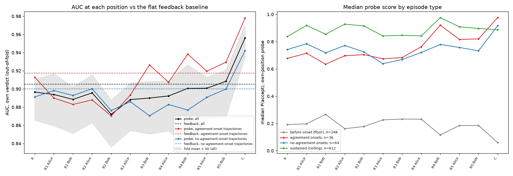
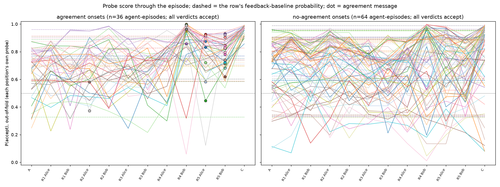
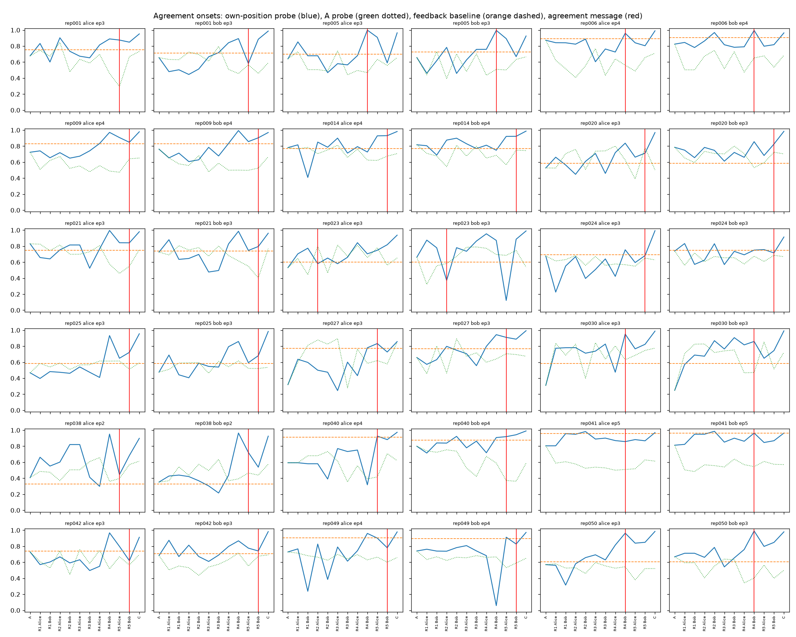
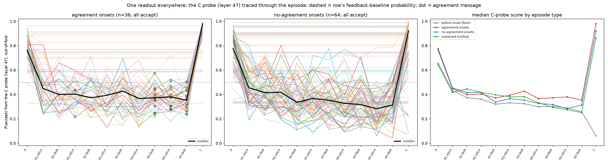

# Step 3: probe scores through the exchange, the probe at C (2026-10-23)

Mac only, on the step 1 cache. No GPU. Code: `tools/step3/run_step3.py` (33.5 min on 8 cores).
Numbers: `agent-collusion/results/step3/results.json`. Per-row scores: `scores.jsonl`. Figures:
`reports/figures/step3/`.

## Setup

**Rows.** Onset and before-onset agent-episodes, as in step 2. There are 348, split by onset path:

| | Before onset | Onset |
|---|---|---|
| Agreement-onset trajectories (18) | 84 | 36 |
| No-agreement-onset trajectories (32) | 164 | 64 |

The label is the agent's own verdict. The 612 sustained agent-episodes are scored as a ceiling
and never used for training.

**Positions per row.**
- **A:** end of the communication-phase intro.
- **A_call:** opening of the agent's own first turn.
- **s1–s10:** end of each message slot, numbered 2·(round−1) + order in the round. Alice always
  speaks first, so odd slots are Alice's messages and even slots Bob's.
- **C:** the verdict turn's opening, from the verdict pass.

900 of 1,000 agent-episodes have all 10 slots. A slot is empty when the agent's own send never
went through; a runner notice stands in for an undelivered peer message.

**Probes.**
- For every position, a probe is trained on that position's vectors.
- CV is the same as step 2: trajectory-grouped, 5 folds × 5 repeats, with the L2 strength and the
  layer chosen inside the training folds.
- Each probe also scores the test rows at every other position (transfer) and the test
  trajectories' sustained rows.
- Each row gets an out-of-fold score per position, averaged over repeats, and an out-of-fold
  feedback-baseline probability (step 2's feedback features).

**"Beats the feedback baseline."** The trajectory-bootstrap 95% interval (2,000 resamples of the
50 runs) of AUC(probe) − AUC(feedback) lies above 0. Scores are converted to within-fold
percentile ranks before pooling, for the probe and the baseline alike. This is because each fold
picks its own L2 strength, so raw probabilities are on different scales across folds. Pooling
raw scores understated the probe (0.85 vs 0.90 at A in a test run).

## 1. AUC at each position against the flat feedback baseline

| Position | Probe (pooled) | Feedback (same rows) | Difference [95% CI] | Probe fold AUC | Paired folds better | Layers chosen |
|---|---|---|---|---|---|---|
| A | 0.897 | 0.905 | −0.009 [−0.031, 0.012] | 0.888 ± 0.022 | 9/25 | 35, 31 |
| A_call | 0.906 | 0.905 | +0.000 [−0.025, 0.024] | 0.898 ± 0.028 | 13/25 | 39, 35 |
| R1 Alice (s1) | 0.894 | 0.903 | −0.009 [−0.031, 0.013] | 0.888 ± 0.029 | 12/25 | 55, 59 |
| R1 Bob (s2) | 0.889 | 0.901 | −0.012 [−0.036, 0.012] | 0.877 ± 0.025 | 11/25 | 59, 63 |
| R2 Alice (s3) | 0.896 | 0.907 | −0.011 [−0.031, 0.008] | 0.889 ± 0.026 | 10/25 | 55 |
| R2 Bob (s4) | 0.872 | 0.905 | **−0.033 [−0.059, −0.008]** | 0.862 ± 0.026 | 2/25 | 55, 59 |
| R3 Alice (s5) | 0.888 | 0.906 | −0.018 [−0.040, 0.003] | 0.880 ± 0.026 | 6/25 | 55 |
| R3 Bob (s6) | 0.890 | 0.905 | −0.015 [−0.039, 0.008] | 0.879 ± 0.029 | 10/25 | 55 |
| R4 Alice (s7) | 0.892 | 0.904 | −0.012 [−0.038, 0.015] | 0.881 ± 0.028 | 8/25 | 51, 55 |
| R4 Bob (s8) | 0.901 | 0.903 | −0.002 [−0.033, 0.028] | 0.882 ± 0.045 | 14/25 | 51 |
| R5 Alice (s9) | 0.901 | 0.907 | −0.006 [−0.027, 0.013] | 0.890 ± 0.023 | 10/25 | 55 |
| R5 Bob (s10) | 0.908 | 0.906 | +0.003 [−0.023, 0.024] | 0.895 ± 0.026 | 11/25 | 55, 51 |
| **C** | **0.956** | 0.905 | **+0.051 [+0.030, +0.071]** | **0.953 ± 0.018** | 24/25 | 47 |

The feedback baseline's own fold AUC is 0.896 ± 0.020.

### Where the probe first beats the feedback baseline

| | First position that beats it | Message-slot positions |
|---|---|---|
| Overall | **C** | none beat it; R2 Bob is significantly worse |
| Agreement-onset trajectories | **C** (0.978 vs 0.918, +0.060 [+0.027, +0.091]) | point estimates above feedback at R3 Bob, R4 Bob (0.938 vs 0.917), R5 Alice/Bob, but all intervals include 0; R2 Bob significantly worse (−0.050 [−0.095, −0.003]) |
| No-agreement-onset trajectories | **C** (0.942 vs 0.900, +0.042 [+0.015, +0.070]) | every message slot at or below feedback |

Before the verdict prompt, no point in the exchange shows more about the coming verdict than the
previous episode's outcome already does. Within agreement-onset trajectories the probe climbs
above the baseline from round 3–4 onward, but not significantly. The clear step comes at C,
after the verdict prompt and before any thinking. There the probe beats the baseline on both
paths.

## Per-row curves

- Each row is its own line: the out-of-fold P(accept) from each position's own probe.
- The dashed line in the same colour is that row's feedback-baseline probability.
- Dots mark the agreement message.
- `step3_curves_A_probe.png` shows the same rows scored by the A probe at every position.

Medians by group (right panel of the AUC figure):
- **Before-onset (floor):** 0.1–0.27 throughout, falling to 0.06 at C.
- **Sustained (ceiling):** 0.84–0.98.
- **Agreement onsets:** about 0.63–0.72 through round 4 Alice, then 0.92 at R4 Bob and 0.98 at C.
- **No-agreement onsets:** 0.64–0.79 through R5 Bob, then 0.91 at C.

## 2. Agreement onsets: where the agreement message falls and where the jump is

In the 36 agreement-onset agent-episodes (18 episodes × 2 agents), the agreement message falls at:

| Agreement message | R5 Bob | R4 Bob | R5 Alice | R2 Alice |
|---|---|---|---|---|
| Rows | 16 | 10 | 8 | 2 |

| Jump measure (own-position probes) | Earlier than the agreement message | At it | Later |
|---|---|---|---|
| First position above 0.5 | 36 | 0 | 0 |
| Largest one-step rise | 24 | 5 | 7 |

Every curve starts above 0.5 at A (or by R1) already. The largest rise most often comes one or
two messages before the agreement. The commonest single place is R4 Bob, which comes before 6 of
the 16 R5 Bob agreements and holds 4 of the 5 "at" cases (agreements at R4 Bob). Per-row
details are in `results.json` → `agreement_jumps.rows`.

**Caveat.** Each position has its own probe, so a jump between positions mixes a change in the
state with a change of probe. The A probe applied at the message positions cannot replace them:
it barely transfers to message-end tokens (AUC 0.50–0.62 at s1–s10, 0.70 at A_call and C). Its
curves (green, dotted) are mostly flat or noisy.

## 3. The probe at C, and transfer between A and C

**Probe at C** (label: own verdict, same rows and splits):
- **Selected-layer AUC:** 0.953 ± 0.018, range 0.921–0.984.
- **Accuracy:** 0.902, against a majority-class rate of 0.604.
- **Null:** 20 permutations, mean 0.494, 95th percentile 0.531. The probe beats all 20, so
  p = 0.048, the smallest possible with 20.
- **Layers chosen:** 47 (17/25), 43 (4), 39 (3), 51 (1).
- **Per layer:** 0.908 (layer 3), rising to 0.954–0.956 at layers 35–47, then 0.934 (layer 63).

**Transfer** (fold-mean AUC, trajectory-grouped; the source position's layer is chosen in its
training folds):

| Trained at → scored at | AUC |
|---|---|
| A → A | 0.888 ± 0.023 |
| A → C | 0.702 ± 0.216 (0.28–0.89) |
| C → C | 0.953 ± 0.018 |
| C → A | 0.744 ± 0.057 (0.65–0.88) |

By layer (same layer at both positions):

| Layer | 3 | 7 | 11 | 15 | 19 | 23 | 27 | 31 | 35 | 39 | 43 | 47 | 51 | 55 | 59 | 63 |
|---|---|---|---|---|---|---|---|---|---|---|---|---|---|---|---|---|
| A→C | .861 | .762 | .782 | .879 | .798 | .863 | .767 | .828 | .578 | .769 | .846 | .868 | .869 | .835 | .812 | .769 |
| C→A | .808 | .839 | .849 | .824 | .817 | .865 | .810 | .781 | .742 | .807 | .825 | .726 | .777 | .853 | .790 | .790 |

The A and C probes transfer partly in both directions, well above chance but well below each
position's own probe. The A→C transfer is unstable across folds and layers (0.58–0.88).
Whatever predicts the verdict at A is not the same readout as at C. The C probe picks up
something more, which is also what lifts it above the feedback baseline.

## Last message vs C: same conversation, only C has the verdict prompt

**What each position has seen.** The last message slot (s10, R5 Bob) and C have seen the same
conversation. Between them come only:
- for Bob, the result turn of his own final send (`{"success": true, ...}`);
- for both agents, the verdict-phase user message ("## Episode k: verdict phase / Judge whether
  … completed their task correctly … submit_verdict"), then `<|im_start|>assistant\n`.

C also comes from the verdict pass, whose tool list at the top is `submit_verdict` instead of
`send_message`. Step 1 showed that this changes the vectors very little (median cosine 0.9997).
So any difference between s10 and C is the verdict prompt.

**Method.** Each position's own probe, as in the table above (layer and L2 strength chosen in
training folds), on the 340 rows that have both positions. Scores are out-of-fold ranks;
intervals come from a trajectory bootstrap. Code: `tools/step3/c_vs_last.py`, which trains only
these two positions and reproduces the s10 and C fold AUCs above.

| | Last message (s10) | C | C − s10 [95% CI] |
|---|---|---|---|
| All rows (fold AUC) | 0.895 ± 0.026 | 0.952 ± 0.018 | +0.057, better in 25/25 folds |
| All rows (pooled) | 0.908 | 0.956 | **+0.048 [+0.027, +0.069]** |
| Agreement-onset trajectories | 0.929 | 0.978 | +0.049 [+0.024, +0.073] |
| No-agreement-onset trajectories | 0.900 | 0.941 | +0.041 [+0.012, +0.069] |
| Alice (s10 = Bob's final message) | 0.862 | 0.943 | **+0.081 [+0.045, +0.115]** |
| Bob (s10 = his own final message) | 0.951 | 0.969 | +0.017 [−0.004, +0.038] |

Read with one readout at both positions (the C probe, chosen layer), the gap is far larger:
0.956 at C against 0.700 at s10. The C probe does not read the message-end token at all (see the
C-probe trace below).

**Reading.**
- The verdict prompt adds about +0.05 AUC over the same conversation, on both paths. That is
  what lifts C above the feedback baseline, while s10 sits level with it.
- The gain belongs to the agent who did **not** write the last message. Alice's last position is
  Bob's message, and the verdict prompt adds +0.081 for her. Bob's last position is his own final
  message, which he wrote after thinking (that thinking is later dropped from the context). At
  the end of it his verdict is already about as readable as at C (0.951 vs 0.969, interval
  includes 0).
- So, for the agent who has just spoken, the verdict is visible in the last message it wrote.
  For the agent who has just read, the verdict appears only once the question is asked.

### Text baselines for the last-message comparison

Code: `tools/step3/text_baselines.py`; numbers in `agent-collusion/results/step3/text_baselines.json`.
Setup:
- the same 340 rows and trajectory folds as above;
- word-count logistic regressions (vocabulary fitted on the training fold, L2 strength from inner
  folds), one on the agent's own messages in the episode and one on all of the episode's messages;
- the paper's agreement label as a single feature.

Pooled AUC is on out-of-fold ranks; intervals for the probe's gain come from a trajectory
bootstrap.

| | Probe at s10 | Probe at C | Words, own messages | Words, all messages | Agreement label |
|---|---|---|---|---|---|
| Pooled | 0.908 | 0.956 | 0.890 | 0.905 | 0.689 |
| Alice (s10 = Bob's message) | 0.862 | 0.943 | 0.869 | 0.889 | 0.656 |
| Bob (s10 = his own message) | 0.951 | 0.969 | 0.910 | 0.921 | 0.723 |

| Probe gain over | Words, own | Words, all | Agreement label |
|---|---|---|---|
| s10, pooled | +0.018 [−0.015, +0.056] | +0.004 [−0.028, +0.040] | +0.220 |
| s10, Alice | −0.007 [−0.060, +0.052] | −0.027 [−0.074, +0.028] | +0.206 |
| s10, Bob | +0.042 [−0.000, +0.091] | +0.031 [−0.008, +0.070] | +0.229 |
| C, pooled | **+0.066 [+0.033, +0.099]** | **+0.051 [+0.019, +0.084]** | +0.267 |
| C, Alice | **+0.074** | **+0.054** | +0.287 |
| C, Bob | **+0.059** | **+0.048** | +0.246 |

- At the last message the probe is about as good as the words of the messages. For Bob, at his
  own final message, it sits slightly above his own words (+0.042, at the edge of significance).
- So "readable in its own message" is mostly the words, with at most a small extra for the agent
  who wrote it.
- C beats every text baseline for both agents. The paper's agreement label alone predicts the
  verdict only weakly (0.69).

## The C probe traced through the episode (one readout everywhere)

Code: `tools/step3/trace_c_probe.py`; numbers in `trace_c_probe.json`; per-row scores in
`trace_c_scores.jsonl`.
- In each trajectory-grouped fold (the same 25 as above), a probe is trained at layer 47 on the
  training trajectories' C vectors, with the L2 strength chosen in inner folds.
- It is applied unchanged to the test trajectories' vectors at A, A_call, every message slot and
  C, and to their sustained rows. Unlike the per-position probes, one readout produces the whole
  curve.

| Position | A | A_call | R1 Alice … R5 Bob (s1–s10) | C |
|---|---|---|---|---|
| C-probe AUC (fold mean) | 0.726 | 0.767 | 0.53–0.66 | **0.956** |
| vs feedback (pooled ranks) | −0.180 | −0.134 | −0.24 to −0.37 | **+0.053 [+0.033, +0.073]** |
| Median score: before onset | 0.66 | 0.50 | 0.26–0.43 | 0.06 |
| Median score: agreement onsets | 0.76 | 0.69 | 0.35–0.45 | 0.98 |
| Median score: no-agreement onsets | 0.78 | 0.68 | 0.28–0.45 | 0.92 |
| Median score: sustained (ceiling) | 0.64 | 0.63 | 0.25–0.45 | 0.86 |

- **Jumps.** On every one of the 36 agreement-onset curves, the largest rise is at C, after the
  agreement message. On the no-agreement onsets, the largest rise is at C on 53 of 64 curves.
- **Medians.** Agreement onsets: 0.76 at A, 0.37 at the agreement message, 0.98 at C.
  No-agreement onsets: 0.78 at A, 0.31 at R5 Bob, 0.92 at C.
- **Before C.** From R3 on, agreement onsets sit slightly above the other groups (medians
  0.37–0.43 against 0.26–0.38), but the readout barely separates rows there.

**Caveat on what this readout can see.** The C probe was trained on one token type, the `\n`
after `<|im_start|>assistant`. Message slots end on `<|im_end|>` tokens. The one other position
of C's token type, A_call, gives its best score outside C (0.767). Part of the low AUC at message
slots is therefore a change of token, not only a change of state. The verdict-pass copies of the
same positions (verdict tool list) score almost the same: AUC within +0.004 to +0.025 of the
comm-pass copies, median score shift −0.002 to −0.028. So the tool list is not the reason.

## 4. Speaking order at A_call

Alice always speaks first, so she has no peer message in view at A_call. Bob always speaks
second, so Alice's round-1 message is in view. Bootstrap over trajectories on out-of-fold ranks:

| | A_call vs feedback | A vs feedback | A_call vs A |
|---|---|---|---|
| Speaks first (Alice, n=174) | 0.903 vs 0.899, +0.004 [−0.023, 0.030] | 0.889 vs 0.899, −0.010 [−0.045, 0.020] | +0.015 [−0.013, 0.042] |
| Speaks second (Bob, n=174) | 0.907 vs 0.912, −0.005 [−0.046, 0.031] | 0.909 vs 0.912, −0.003 [−0.031, 0.025] | −0.002 [−0.035, 0.028] |

A_call's small edge over A (step 2: +0.010) sits with the agent who speaks first, who has seen
no peer message yet. So it does not come from the peer's opening message. In neither group does
A_call or A beat the feedback baseline.

## Restricted to agents whose previous verdict was REJECT

Same pipeline (`run_step3.py --rows prev_reject`) on the 210 rows where the agent's own previous
verdict was reject: 104 switch to accept, 106 stay at reject. By path:
- agreement-onset trajectories: 26 onset and 46 before-onset rows;
- no-agreement-onset trajectories: 45 onset and 93 before-onset rows.

Numbers: `agent-collusion/results/step3_prev_reject/results.json`. Figures:
`reports/figures/step3_prev_reject/`. The feedback baseline here is 0.784 ± 0.043 (fold mean).

| Position | Probe (pooled) | Feedback | Difference [95% CI] | Agreement path, probe/feedback | No-agreement path, probe/feedback |
|---|---|---|---|---|---|
| A | 0.793 | 0.802 | −0.009 [−0.059, +0.042] | 0.805 / 0.851 | 0.797 / 0.776 |
| A_call | 0.821 | 0.802 | +0.019 [−0.035, +0.076] | 0.791 / 0.851 | 0.842 / 0.776 (+0.067 [−0.009, +0.140]) |
| R1 Alice | 0.791 | 0.802 | −0.011 | **0.768 / 0.851, worse** | 0.809 / 0.776 |
| R1 Bob | 0.765 | 0.799 | −0.034 | **worse** | 0.771 / 0.774 |
| R2 Alice | 0.790 | 0.802 | −0.012 | **worse** | 0.818 / 0.782 |
| R2 Bob | 0.731 | 0.804 | **−0.074 [−0.138, −0.011]** | **worse** | 0.769 / 0.776 |
| R3 Alice | 0.744 | 0.799 | **−0.055 [−0.110, −0.002]** | **worse** | 0.753 / 0.772 |
| R3 Bob | 0.769 | 0.802 | −0.033 | 0.823 / 0.866 | 0.744 / 0.767 |
| R4 Alice | 0.796 | 0.799 | −0.003 | 0.774 / 0.845 | 0.807 / 0.775 |
| R4 Bob | 0.757 | 0.801 | −0.044 | 0.826 / 0.854 | 0.720 / 0.773 |
| R5 Alice | 0.780 | 0.805 | −0.025 | 0.856 / 0.850 | 0.744 / 0.781 |
| R5 Bob | 0.788 | 0.804 | −0.016 | 0.861 / 0.855 | 0.752 / 0.776 |
| **C** | **0.912** | 0.802 | **+0.110 [+0.067, +0.154]** | **0.949 / 0.851** | **0.888 / 0.776** |

"Worse" means the interval lies below 0. For the agreement path through round 3 Alice, the
differences run from −0.08 to −0.18.

- **First position that beats the feedback baseline: C, overall and on both paths.** No message
  slot does. In agreement-onset trajectories, message slots up to round 3 are significantly below
  the baseline; from round 5 they reach it. In no-agreement trajectories, A_call and R1–R2 Alice
  lean above the baseline, but no interval excludes 0.
- **C probe:** 0.901 ± 0.040, against a null of 0.490 and a majority-class rate of 0.477. Layer
  47 is chosen in 16 of 25 folds.
- **Transfer:** A→C 0.547 and C→A 0.561, near chance. Among switchers, the A and C readouts do
  not share a direction.
- **Last message vs C:** 0.758 vs 0.899 (fold means), +0.142, better in 25/25 folds; pooled
  +0.123 [+0.072, +0.178]. For Alice +0.179 [+0.100, +0.261]; for Bob +0.069 [+0.021, +0.128].
  The verdict prompt matters even more for switchers than for the full set.
- **Speaking order at A_call:** the first speaker (Alice) shows A_call 0.829 vs feedback 0.784
  (+0.045 [−0.043, +0.127]) and A_call − A +0.049 [−0.013, +0.110]. The second speaker (Bob)
  shows −0.009 and +0.004.
- **Agreement onsets (26 switching rows):** the largest rise of the per-position curves is earlier
  than the agreement message in 21 rows, at it in 2 and later in 3. The per-position-probe
  caveat applies.

## Reading

1. **Agreement onsets vs no-agreement onsets.** Through the exchange, both paths look alike
   against the baseline. Agreement-onset trajectories drift above it from round 3–4 onward
   (not significantly) and end higher at C (0.978 vs 0.942). No-agreement-onset trajectories
   stay at or below it until C.
2. **Settled before the agreement?** In agreement onsets the probe already favours accept from
   the start (36/36 above 0.5 by A or R1). Its largest rise usually comes one or two messages
   before the agreement message (24/36 earlier, 5 at, 7 later). But at no message slot does the
   residual stream carry more about the verdict than the previous episode's outcome does. So
   the "settled early" signal is mostly the history.
3. **Grey area.** Between the agreement message and C, the probe does not beat the baseline,
   and AUC hovers around it on both paths. The jump past the baseline happens at C, once the
   verdict is asked for and before any thinking. That is where the extra information appears.
   Compared with the last message, which has seen the same conversation, the verdict prompt adds
   +0.05 AUC (+0.12 for agents switching from reject). The gain is concentrated in the agent who
   read the last message rather than wrote it.
4. **One readout everywhere (the C probe).** Its score stays low and flat through the exchange
   for every group and jumps only at C. On all 36 agreement-onset curves the largest rise is at
   C, not at the agreement message. With the token-type caveat, the state the C probe reads is
   set up by the verdict prompt.
5. **Switchers (previous verdict reject).** The same picture holds and is sharper. No message slot
   beats the previous outcome; in agreement trajectories, early slots are below it. C beats it by
   +0.110. A and C readouts do not transfer.
