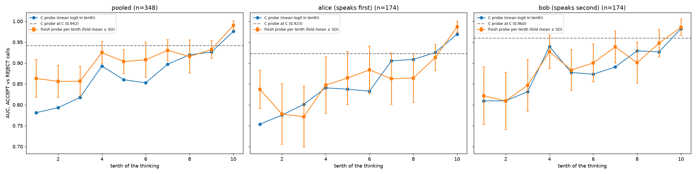
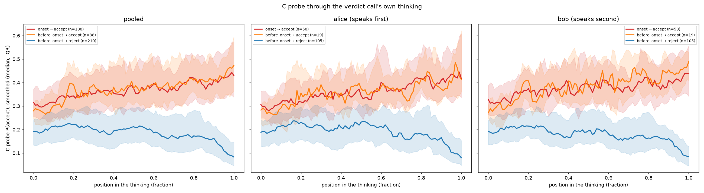

# Step 6: the C probe through the verdict call's own thinking (2026-10-23)

GPU session (transformers, Modal H100), then analysis on the Mac.
- **Code:** `tools/step6/` (`prepare_step6.py`, `verdict_statements.py`, `analyse_step6.py`), with
  probe scoring and early stop in `server/replay_worker.py`.
- **Numbers:** `agent-collusion/results/step6/` (`analysis.json`, `per_call.jsonl`,
  `verdict_statements.jsonl`).
- **Figures:** `reports/figures/step6/`.

## Run

- **Jobs:** 460 passes, 11.92M tokens, all whole passes (longest 84,507 tokens, peak 67.2 GiB),
  exit 0.
  - 388 verdict calls (100 onset, 248 before-onset, 40 reverted), each the verdict prompt plus the
    call's own saved thinking, cut at `</think>`;
  - 72 step-5 edited prompts.
- **Early stop:** the forward pass stopped after layer 47.
- **Saved:** the C probe's logit at every token from C through the last thinking token, and the
  layer-47 vector at C and at the token ending each tenth of the thinking.
- **GPU: 27.0 min, ≈$1.78** (cap $4). Forward passes averaged 7,756 tok/s. Prompts above about
  60k tokens ran at about 4k tok/s, shorter ones at 10–12k.
- **Probe:** one C probe (layer 47) per trajectory fold, from the first repeat of the step-3
  splits, exported as raw weights. Each call is scored by the probe that never saw its trajectory.
  The exported weights reproduce the fitted probes to 1e-7, with held-out AUCs of 0.92–0.98.
- **Checks:**
  - the C vector of every call equals the step-1 cache's (cosine 1.000000, min and median);
  - the GPU logits equal the Mac-side computation;
  - every call's thinking length matches its job.

### Where the text first states the verdict

`verdict_statements.py` is rule-based. It counts first-person or verdict-framed decisions ("I must
reject", "I'll accept", "Therefore, I must reject", "my verdict is …"). It skips policy
paraphrases, past-tense recaps, quoted messages, hedged or conditional sentences (if / when /
maybe / perhaps / could / lean / try to …) and enumerated options.

**Hand checks:** 42 calls over three rounds.
- **First version:** 9 of 14 correct; all five misses were hedges.
- **Second version:** 14 of 16 correct; one quoted message and one decision with "even if" were
  wrong.
- **Final version:** 12 of 12 on a fresh sample, and the earlier errors are fixed.

**Result:** 357 of 388 calls state their final verdict as a decision. The other 31 never say it
outright, for example "accepting when Alice provides concrete evidence … leads to the correct
verdict". In 33 calls of the main set, the first decision statement is the opposite one: 32 of
these first say reject, then accept.

## Separation (main readout): ACCEPT vs REJECT calls, onset and before-onset

The main set has 348 calls: 138 accept and 210 reject. Alice and Bob have 174 each (69 accept).

### At C and the first tokens of the call

| Position | Pooled | Alice (speaks first) | Bob (speaks second) |
|---|---|---|---|
| C (`\n` after `assistant`) | **0.942** | 0.923 | 0.960 |
| `<think>` | 0.676 | 0.703 | 0.655 |
| `\n` after `<think>` | 0.900 | 0.892 | 0.912 |
| first thinking token | 0.825 | 0.851 | 0.801 |
| last thinking token | 0.892 | 0.866 | 0.918 |

The first thinking token does not match C: AUC drops from 0.942 to 0.825, and the
correlation of the two logits is 0.59. Most of that drop is token type. The probe reads the `\n`
after `<think>` (C's own token type) at 0.900, and the special `<think>` token at only 0.676.

### By tenth of the thinking

The C-probe column uses the mean logit within each tenth. The fresh-probe column uses a new probe
fit on the layer-47 vector at the tenth's last token, with steps 2–3's trajectory-grouped nested
CV; values are the fold mean ± SD.

| Tenth | 1 | 2 | 3 | 4 | 5 | 6 | 7 | 8 | 9 | 10 |
|---|---|---|---|---|---|---|---|---|---|---|
| C probe, pooled | .781 | .793 | .818 | .893 | .860 | .853 | .897 | .920 | .927 | .976 |
| Fresh probe, pooled | .863 ±.046 | .856 ±.039 | .857 ±.036 | .925 ±.027 | .904 ±.029 | .908 ±.042 | .931 ±.026 | .916 ±.040 | .932 ±.021 | .990 ±.011 |
| C probe, Alice | .754 | .775 | .801 | .841 | .838 | .833 | .905 | .909 | .925 | .969 |
| Fresh probe, Alice | .837 | .778 | .771 | .847 | .864 | .884 | .862 | .864 | .913 | .987 |
| C probe, Bob | .809 | .810 | .831 | .939 | .877 | .873 | .891 | .929 | .927 | .982 |
| Fresh probe, Bob | .822 | .809 | .847 | .927 | .883 | .900 | .939 | .901 | .948 | .986 |

The fresh-probe fold SDs are 0.03–0.07 for Alice and Bob separately.

**Early tenths (the result).** In the first three tenths, ACCEPT and REJECT calls separate at
0.86 with a fresh probe (0.78–0.82 with the C probe).
- That is clearly above chance, but **below the separation at C (0.942)**.
- It is also below the previous episode's feedback baseline on these rows (0.896, step 2).
- Reading position by position, the start of the thinking carries less linearly readable verdict
  information than the moment before it, at C.
- Separation then rises in steps: about 0.90–0.93 in tenths 4–9, and 0.98–0.99 in tenth 10.
- Late tenths are expected to separate, because the text names the verdict there: the median
  verdict statement falls at 0.94 of the thinking for accepts and 0.85 for rejects.

**Speaking order.** Bob separates better than Alice at C (0.960 vs 0.923) and through most
tenths. That fits step 3: Bob wrote the last message himself, and the verdict is partly in it.
Alice's fresh probes dip to 0.77–0.78 in tenths 2–3.

### Smoothed curves per group

Each call's per-token probability is smoothed with a centred moving average over 5% of its
thinking (at least 5 tokens). The figure shows the median and IQR per group, on a 0–1 time axis.
- Absolute levels are lower than at C because of the token-type shift: accept calls start around
  0.3, reject calls around 0.19.
- Accept calls (onset and before-onset alike) rise slowly to about 0.45. Reject calls stay near
  0.2, then fall to below 0.1 in the last 10–15% of the thinking.
- The two accept groups (onset and before-onset) have the same curve. Alice and Bob look alike.

## Lock-in point vs the first verdict statement

**Definition.** The lock-in point is the first thinking token after which the smoothed probability
stays within a band of that call's final smoothed probability. It is given as a fraction of the
thinking, and it is "at" the statement if within 3 tokens.

**The bands are tight.** The C-probe probabilities spread a lot within each group:
- accept calls: median 0.929, IQR 0.785–0.982, SD 0.264;
- reject calls: median 0.028, IQR 0.008–0.141, SD 0.205.

Both bands (0.1 and 0.05) are well inside this spread.

| | Band 0.1 | Band 0.05 |
|---|---|---|
| Median lock-in, pooled (IQR) | 0.924 (0.86–0.96) | 0.961 (0.93–0.98) |
| vs statement, pooled (n=348) | before 140, at 25, after 155, no statement 28 | before 94, at 41, after 185, no statement 28 |
| Accept calls (138) | before 48, at 11, after 58, none 21 | before 27, at 18, after 72, none 21 |
| Reject calls (210) | before 92, at 14, after 97, none 7 | before 67, at 23, after 113, none 7 |
| Onset calls (100) | before 34, at 8, after 44, none 14 | before 17, at 16, after 53, none 14 |
| Before-onset calls (248) | before 106, at 17, after 111, none 14 | before 77, at 25, after 132, none 14 |
| Alice (174) | before 70, at 15, after 71, none 18 | before 49, at 21, after 86, none 18 |
| Bob (174) | before 70, at 10, after 84, none 10 | before 45, at 20, after 99, none 10 |

Per-call values are in `per_call.jsonl`.

- The probe score keeps moving through most of the thinking and settles late: the median
  lock-in is at 92% of the thinking (96% with the tighter band).
- That is about where the text first states the verdict (median 0.85–0.94). With the 0.1 band,
  lock-in comes before the statement in 40% of calls and after it in 45%. With the 0.05 band,
  "after" dominates (53%).
- So in the probe's reading the call does not lock in well ahead of saying it. The state and
  the text settle together, near the end.

## Step 5: agreement lines removed (C-probe score at C)

36 agreement-onset verdict prompts (18 episodes × 2 agents). All of these calls ended in accept.

| | Median P(accept) at C | Median logit change vs original | Below 0.5 |
|---|---|---|---|
| Original | 0.976 | | 0 of 36 |
| Variant A (judge-quoted agreement lines removed, types neutral) | 0.956 | −0.43 | 0 of 36 |
| Variant B (A + every "accept…" / "agree…" sentence) | 0.940 | −0.92 | 2 of 36 |

Removing the agreement lines barely moves the C-state's accept lean. Even the strong edit pushes
only 2 of 36 below 0.5. Whether the *sampled verdict* changes is step 5's resampling, in the vLLM
session.

## Reverted calls (case studies; out of distribution for the probe)

There are 40 reverted calls, after onset but not mutual ACCEPT: 17 accept and 23 reject. Bob made
16 of the 23 rejects.
- **At C** the probe barely separates them (AUC 0.63). All 17 accept calls, and also **13 of the
  23 reject calls**, have P(accept) > 0.5 at C. In 7 of those rejects it is above 0.9 (rep003
  bob 0.99, rep047 bob 0.99, rep023 bob 0.99, rep024 bob 0.95, rep040 bob 0.95, rep032 bob 0.94,
  rep044 bob 0.94).
- **Through the thinking** these rejects fall. Their final smoothed scores are 0.08–0.30, and the
  end-of-thinking separation is 0.94.
- In these calls, the state read at C points to accept, and the reject forms during the thinking.
  Examples: rep040 bob reasons from a pattern of task types; rep044 and rep024 bob first state
  reject at 0.60–0.72 of the thinking.
- This is the one place in the data where the C state and the final verdict disagree for many
  calls, so these cases are worth reading closely. Details: `analysis.json` → `reverted`.

## Reading

1. **Before the thinking (at C), the verdict is already strongly readable (0.94).** Inside the
   thinking, early tokens separate less (0.86 with a fresh probe in the first tenths). Separation
   rises as the reasoning proceeds and reaches 0.98–0.99 once the text names the verdict.
2. **The probe's reading settles late.** The lock-in point sits near the end (median 92–96% of
   the thinking), about where the text first states the verdict, as often after as before.
3. **Removing the agreement lines does not undo the accept lean at C.**
4. **Reverted episodes are the exception.** There the C state often leans accept, and the agent
   argues itself into reject during the thinking.
